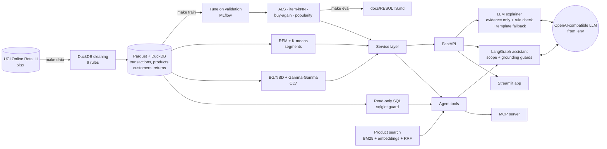

# ShopSage

[](https://github.com/srghosh56/shopsage/actions/workflows/ci.yml)
[](LICENSE)

Recommendations and customer analytics on the **UCI Online Retail II** dataset (a UK online
gift-ware wholesaler, 2009–2011, CC BY 4.0). Classic ML does the work: ALS and item-kNN
recommenders, RFM segments and BG/NBD + Gamma-Gamma CLV, all evaluated on a time-based split
against baselines. An LLM only **explains** what the models found, and its text is checked
against the evidence. A **LangGraph assistant** answers questions by calling those models as tools,
which are also exposed over **MCP**.

## Key results

<!-- KEY-RESULTS:START -->
**Recommenders** — test window 2011-09-01..2011-11-30, 2,241 warm
customers (`all`) / 2,150 (`new` = only never-bought items):

| model | NDCG@10 (all) | HitRate@10 (all) | NDCG@10 (new items) | HitRate@10 (new items) | coverage (new) |
|---|---:|---:|---:|---:|---:|
| popularity | 0.114 | 0.547 | 0.044 | 0.290 | 0.018 |
| recent_popularity | 0.110 | 0.477 | 0.054 | 0.294 | 0.016 |
| buy_again | 0.367 | 0.814 | 0.044 | 0.290 | 0.018 |
| item_knn | 0.234 | 0.674 | 0.080 | 0.419 | 0.278 |
| als | 0.319 | 0.783 | 0.089 | 0.456 | 0.184 |

**CLV** (6-month holdout, 4,932 customers): BG/NBD purchases MAE
1.04 vs naive 1.08, total purchases error
-2.6%; revenue total error -15.5%
(naive -20.6%); predicted top 20% earned
76.1% of holdout revenue.

**Assistant** (40 questions, local LLM): correct in-scope answers 93%
with tools vs 7% without; right tool 100%;
out-of-scope refused 86% (no tools: 57%).

**Explanations** (30 labelled by one human): 24 faithful; the rule check
let through 6 of the 6 unfaithful ones. See RESULTS section 4.

Full tables and caveats: [docs/RESULTS.md](docs/RESULTS.md). Generated by `scripts/update_docs.py`.
<!-- KEY-RESULTS:END -->

## Architecture



## How to run

Requirements: [uv](https://docs.astral.sh/uv/), make, and an OpenAI-compatible LLM endpoint
(e.g. [Ollama](https://ollama.com) with `ollama pull mistral`) for the explanation and assistant
parts. Everything else runs on CPU.

```bash
cp .env.example .env          # set LLM_BASE_URL / LLM_API_KEY / LLM_MODEL
make setup                    # Python 3.12 + pinned dependencies (uv.lock)
make data                     # download from UCI, clean with DuckDB → data/processed/
make eda                      # execute notebooks/eda.ipynb
make train                    # tune recommenders (MLflow), fit serving models, segments, CLV
make eval                     # test-window comparison → docs/RESULTS.md
make serve                    # FastAPI on :8000 (API_PORT=8010 make serve to change)
make ui                       # Streamlit on :8501, talks to the API
make mcp                      # MCP server over stdio
make explain-eval             # 30 explanations, LLM judges → docs/labels/explanations.csv
make agent-eval               # 40-question assistant evaluation vs no tools
make faithfulness             # human labels vs LLM judges (Cohen's kappa)
make test lint                # pytest on a fixture (no download, no LLM); ruff + mypy
uv run python scripts/update_docs.py   # refresh the key-results blocks
```

MLflow runs: `uv run mlflow ui --backend-store-uri sqlite:///mlflow.db`.

**Docker** (after `make data train eval` on the host, LLM on the host):

```bash
docker compose up --build     # API on :8000, UI on :8501 (API_PORT / UI_PORT to change)
```

**MCP client config:**

```json
{"mcpServers": {"shopsage": {"command": "uv",
  "args": ["--directory", "/path/to/shopsage", "run", "python", "-m", "shopsage.agent.mcp_server"]}}}
```

### API

| Endpoint | What it returns |
|---|---|
| `GET /customers/{id}` | RFM, segment, 12-month CLV, P(alive), top items |
| `GET /customers/{id}/recommendations?mode=discover\|buy_again&k=` | ranked items + evidence (similar past purchases, co-purchase counts, popularity, own history) |
| `GET /customers/{id}/explanations` | the same + a 1–2 sentence LLM explanation per item (checked; template fallback; cached) |
| `GET /items/{code}/similar` | most co-purchased items |
| `GET /products/search?q=` | hybrid BM25 + embedding search |
| `GET /segments`, `/clv/segments`, `/clv/validation`, `/models/comparison` | analytics and evaluation results |
| `POST /assistant/chat` | assistant answer + the tool calls it made |

## Project layout

```
src/shopsage/
  data/        download, DuckDB cleaning, test fixture builder
  eval/        time split, hand-written metrics, evaluation runner
  recsys/      interactions, baselines, item-kNN, ALS, tuning (MLflow), test comparison
  analytics/   RFM + K-means segments, BG/NBD + Gamma-Gamma CLV
  llm/         OpenAI-compatible client, explainer + guard, judges, agreement
  search/      BM25 + embeddings + RRF product search
  agent/       tools, read-only SQL, LangGraph graph, MCP server, 40-question eval
  api/         FastAPI app
  service.py   one service layer for API, agent and MCP
app/           Streamlit UI (calls the API)
docs/          RESULTS, DECISIONS, MODEL_CARD, figures, labels
notebooks/     executed EDA
tests/         pytest on a 30k-row fixture of the real data
```

## Limitations

- **Old, single-shop data (2009–2011).** Results don't transfer to other shops without retraining.
- **Seasonality.** The test window is the Q4 peak, and CLV under-predicts Q4 revenue. Use CLV for
  ranking customers, not for setting budgets.
- **Warm customers only.** New customers get popularity; cold-start quality is not measured.
- **Catalogue drift.** Items first sold in the test window can't be recommended.
- **LLM quality depends on the model.** With a 7B local model, explanations can be embellished. The
  rule check blocks invented products, numbers and taste claims, but not every unsupported phrasing;
  in a human-labelled sample, the unfaithful explanations all passed it. The sample is 30 rows from
  one rater.
  The assistant can still pick the wrong tool; its guard may then return raw tool output.

More detail: [docs/MODEL_CARD.md](docs/MODEL_CARD.md).

## Documentation

- [docs/RESULTS.md](docs/RESULTS.md): all measured results with interpretation
- [docs/DECISIONS.md](docs/DECISIONS.md): cleaning rules with row counts, design decisions
- [docs/MODEL_CARD.md](docs/MODEL_CARD.md): data, metrics, limitations
- [notebooks/eda.ipynb](notebooks/eda.ipynb): exploratory analysis and five findings

Data: Chen, D. (2012). *Online Retail II* [Dataset]. UCI Machine Learning Repository,
CC BY 4.0.

## License

Code: [MIT](LICENSE). Data: CC BY 4.0, not included in this repository (`make data` downloads it),
except for a small sample in `tests/fixtures/`.
