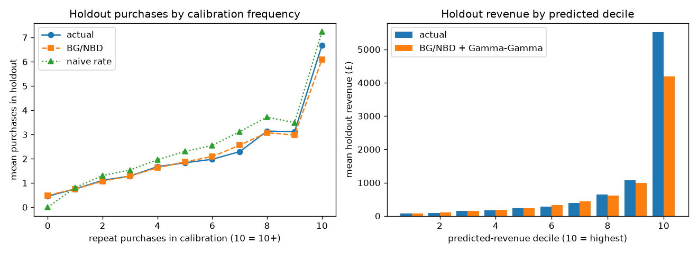

# Results

Every number in this file is produced by a script in the repo; generated blocks sit between
`<!-- NAME:START/END -->` markers and are overwritten when the script runs again.

## 1. Recommendations (test window)

<!-- RECSYS:START -->
All metrics @10, test window 2011-09-01 to 2011-11-30, models refit on everything before
2011-09-01 with the parameters chosen on validation (NDCG@10). Generated by
`python -m shopsage.recsys.evaluate`. CI = 95% bootstrap interval over users (1,000 resamples).
`val ndcg` = NDCG@10 of the same configuration on the validation window (Jun–Aug 2011).

**Protocol `all`** — any item bought in the window counts (2,241 warm customers).

| model | precision | recall | ndcg | map | hit_rate | coverage | diversity | pop_bias | ndcg 95% CI | val ndcg |
|---|---:|---:|---:|---:|---:|---:|---:|---:|---:|---:|
| popularity | 0.1032 | 0.0314 | 0.1140 | 0.0508 | 0.5471 | 0.0023 | 0.6875 | 0.9990 | 0.1081–0.1200 | 0.1225 |
| recent_popularity | 0.1070 | 0.0292 | 0.1098 | 0.0552 | 0.4770 | 0.0023 | 0.6566 | 0.9860 | 0.1024–0.1162 | 0.1609 |
| buy_again | 0.3152 | 0.1375 | 0.3673 | 0.2530 | 0.8139 | 0.4804 | 0.7810 | 0.9133 | 0.3552–0.3799 | 0.3903 |
| item_knn | 0.2148 | 0.0797 | 0.2337 | 0.1423 | 0.6743 | 0.2518 | 0.6776 | 0.9492 | 0.2237–0.2443 | 0.2604 |
| als | 0.2780 | 0.1138 | 0.3188 | 0.2081 | 0.7827 | 0.1586 | 0.6832 | 0.9733 | 0.3072–0.3297 | 0.3442 |

**Protocol `new`** — only items the customer never bought before; bought items are excluded
from the lists (2,150 customers with at least one new item).

| model | precision | recall | ndcg | map | hit_rate | coverage | diversity | pop_bias | ndcg 95% CI | val ndcg |
|---|---:|---:|---:|---:|---:|---:|---:|---:|---:|---:|
| popularity | 0.0411 | 0.0176 | 0.0435 | 0.0166 | 0.2902 | 0.0177 | 0.6966 | 0.9984 | 0.0397–0.0473 | 0.0422 |
| recent_popularity | 0.0502 | 0.0201 | 0.0538 | 0.0229 | 0.2944 | 0.0159 | 0.6684 | 0.9765 | 0.0494–0.0586 | 0.1000 |
| buy_again | 0.0411 | 0.0176 | 0.0435 | 0.0166 | 0.2902 | 0.0177 | 0.6966 | 0.9984 | 0.0397–0.0473 | 0.0422 |
| item_knn | 0.0711 | 0.0382 | 0.0797 | 0.0343 | 0.4191 | 0.2784 | 0.7349 | 0.9422 | 0.0741–0.0851 | 0.0880 |
| als | 0.0783 | 0.0399 | 0.0894 | 0.0397 | 0.4558 | 0.1836 | 0.7560 | 0.9534 | 0.0839–0.0950 | 0.0899 |

Chosen parameters:
- `popularity`: all = `{}`, new = `{}`
- `recent_popularity`: all = `{'window_days': 30}`, new = `{'window_days': 30}`
- `buy_again`: all = `{'half_life_days': 180}`, new = `{'half_life_days': 14}`
- `item_knn`: all = `{'n_neighbors': 5, 'shrink': 50, 'weighting': 'log'}`, new = `{'n_neighbors': 10, 'shrink': 10, 'weighting': 'log'}`
- `als`: all = `{'factors': 256, 'regularization': 5.0, 'alpha': 0.25, 'iterations': 20, 'weighting': 'log'}`, new = `{'factors': 256, 'regularization': 5.0, 'alpha': 0.25, 'iterations': 20, 'weighting': 'log'}`
<!-- RECSYS:END -->

### What wins and why

- **When repeat purchases count (`all`), "buy again" wins, and it isn't close.** Its NDCG@10 is
  0.367 against 0.319 for ALS, the best learned model; the bootstrap intervals don't overlap.
  This is a wholesale shop: 72% of customers order more than once and a quarter of
  customer–item pairs are re-bought (see the EDA). The best predictor of next quarter's basket is
  last quarter's basket. ALS gets closest, probably because with strong regularisation and low alpha it
  largely reconstructs each customer's own history. Item-kNN zeroes self-similarity by design, so it can
  only re-recommend an owned item through its neighbours.
- **For discovery (`new`), the collaborative models win.** ALS (0.089) and item-kNN (0.080) are
  both clearly above recent popularity (0.054) and all-time popularity (0.044), with
  non-overlapping intervals. Hit rate rises from 29% to 46% of customers. They also show much more
  of the catalogue (coverage 18–28% vs under 2%) and are less biased toward best-sellers.
  Item-kNN has the highest coverage. ALS has the best accuracy and diversity. The ALS–kNN gap is
  small and their intervals touch, so treat them as close.
- **Validation and test disagree on the baselines.** On the summer validation window, recent
  popularity scored 0.100 in `new` and beat both CF models. In the autumn test window it falls to
  0.054, because the Christmas range takes over and last month's best-sellers stop predicting next
  month's. CF models were stable (ALS 0.090 val vs 0.089 test). That is a reason to prefer them
  despite the validation ranking, and a reminder that a single time split can mislead under
  strong seasonality.
- **Absolute numbers are low**, as is normal for implicit feedback with large baskets: a customer
  buys about 20 distinct items per order, so recall@10 is capped well below 1.
- **What the product does with this:** the API shows a "buy again" list (best model for repeats)
  next to "you may also like" from ALS with already-bought items excluded (best model for
  discovery). Item-kNN supplies the evidence for each recommendation: similar past purchases and
  co-purchase counts.

## 2. Customer segments (RFM + K-means)

<!-- SEGMENTS:START -->
RFM on all 5,839 customers (snapshot 2011-12-10),
log + standardised features, K-means with k chosen by silhouette (k=4: 0.363, k=5: 0.342, k=6: 0.336) → **k = 4**.
Names come from each centroid's position (rule in `analytics/segments.py::name_segment`).
Generated by `python -m shopsage.analytics.segments`.

| segment | customers | median_recency_days | median_orders | median_revenue | share_customers | share_revenue | action |
|---|---:|---:|---:|---:|---:|---:|---:|
| Champions | 1153 | 16 | 13.0 | £4,971 | 19.7% | 73.1% | Reward and ask for referrals; early access to new ranges. |
| At risk | 1474 | 177 | 5.0 | £1,459 | 25.2% | 16.9% | Win-back campaign before they lapse: they used to buy often. |
| Promising new | 1234 | 23 | 3.0 | £716 | 21.1% | 6.3% | Onboarding offers to secure the second and third order. |
| Hibernating | 1978 | 400 | 1.0 | £270 | 33.9% | 3.8% | Low-cost reactivation only; don't over-invest. |
<!-- SEGMENTS:END -->

## 3. Customer lifetime value (BG/NBD + Gamma-Gamma)

<!-- CLV:START -->
Calibration: orders up to 2011-06-09; holdout: the next 183 days to
2011-12-09; 4,932 customers who bought in calibration. Same-day orders count as
one purchase (time unit = day). Fitted by MAP with `pymc-marketing`. Naive baseline = the
customer's calibration repeat rate × holdout length (× their average order value for revenue).
Generated by `python -m shopsage.analytics.clv`.

| target | model | MAE | RMSE | total error | Spearman |
|---|---:|---:|---:|---:|---:|
| orders per customer | BG/NBD | 1.04 | 1.78 | -2.6% | 0.623 |
| orders per customer | naive rate | 1.08 | 1.91 | +3.5% | 0.574 |
| revenue per customer (£) | BG/NBD + Gamma-Gamma | 555.05 | 2413.78 | -15.5% | 0.613 |
| revenue per customer (£) | naive rate × AOV | 584.10 | 2845.12 | -20.6% | 0.584 |

- Actual holdout totals: 7,748 purchases, £4,276,903 revenue.
- Customers ranked in the model's top 20% earned **76.1%** of actual
  holdout revenue (naive ranking: 75.6%).
- Serving model (refit on all data): median 12-month CLV £552,
  total £8,734,172 across 5,839 customers.

<!-- CLV:END -->

**Reading the CLV numbers.** BG/NBD predicts *how many* purchases well: total purchases are within
a few percent, and the left plot tracks actual purchases in every calibration-frequency bucket.
It beats the naive rate on every error metric. Revenue is under-predicted in total, and the gap is
concentrated in the top decile (right plot). The holdout runs June–December, so it includes the
autumn peak (Sep–Nov is 37% of all revenue in the data, per the EDA). BG/NBD and Gamma-Gamma assume a stationary
purchase rate and spend, so they can't see seasonality, and the biggest wholesale customers
spend most in Q4. The model's ranking is what the segments and API use, and that holds up: the
predicted top 20% earned about three-quarters of actual holdout revenue. The naive
ranking does almost as well on that measure, so the main gain over naive is in error size and
rank correlation (Spearman), not top-20% capture. Use CLV to rank and
prioritise customers. Don't use the absolute £ figures for a budget without a seasonal correction.

## 4. LLM explanations: faithfulness

<!-- EXPLAIN:START -->
Generator: `mistral` (from `.env`), prompted with the evidence as plain facts.
Judges: `mistral`, `gemma3:latest`, each with a strict claim-by-claim rubric, seeing
only the facts and the explanation. 10 seeded-random customers x 3 recommendations
(5 customers "discover", 5 "buy again") = 30 explanations. Rule-check rejection reasons:
{'names products not in evidence': np.int64(2), 'unsupported claim about tastes or qualit': np.int64(1)}. Generated by `python -m shopsage.llm.judge`; rows are in
`docs/labels/explanations.csv` for human labelling (`make faithfulness`).

| metric | mistral | gemma3:latest |
|---|---:|---:|
| passed the rule-based check (else template) | 90% | 90% |
| judge: raw LLM explanation faithful | 97% | 10% |
| judge: faithful among check-passed | 100% | 11% |
| judge: faithful among check-rejected | 67% | 0% |
| served output faithful (passed & faithful, or template) | 100% | 20% |
| rule check and judge agree | 93% | 20% |
| judge-vs-judge agreement (mistral vs gemma3:latest) | 13% |  |
<!-- EXPLAIN:END -->

**Reading this.** The two judges almost never agree, so "the LLM judge says X% faithful" depends
mostly on which LLM you ask. Reading the rows, Mistral passes explanations that add framing such
as "making it a popular choice among…". gemma3 fails nearly everything, including texts that only
restate the facts in different words. That is why all 30 rows were labelled by a
human, and `make faithfulness` reports agreement (Cohen's kappa) between those labels and each
judge. The deterministic rule check is the guard the API uses. It looks for product names and numbers
that aren't in the evidence and for claims about the customer's tastes, and anything it rejects is
replaced by a template built only from the evidence.

### Human labels vs judges

<!-- HUMAN_AGREEMENT:START -->
Human labels vs each LLM judge (`make faithfulness`):

| judge | labelled | agreement | Cohen's kappa | human faithful | judge faithful |
|---|---:|---:|---:|---:|---:|
| `mistral` | 30 | 77% | -0.06 | 80% | 97% |
| `gemma3:latest` | 30 | 23% | -0.04 | 80% | 10% |

| group | labelled | human faithful |
|---|---:|---:|
| passed the rule check | 27 | 21 |
| rejected by the rule check | 3 | 3 |
| mode: buy_again | 15 | 9 |
| mode: discover | 15 | 15 |
<!-- HUMAN_AGREEMENT:END -->

**Reading this.** Both kappas are close to zero, so neither judge agrees with the human beyond
chance: Mistral passes nearly everything and gemma3 fails nearly everything. Neither is usable as a
faithfulness metric here. The human labels therefore give the most reliable reading: 24 of 30 faithful, and 15 of 15 on the
"discover" list. The 6 unfaithful explanations all passed the rule check, because their problems
were looser than an unknown product or number, such as implying that items were bought together or
attaching a count to the wrong product. All 6 came from the "buy again" list, where the facts mix
what the customer bought with what other customers bought, so that prompt is the clearest next
improvement. The 3 explanations the check rejected were labelled faithful; a rejection costs little,
because the customer still gets the evidence through the template. The labels come from one rater
on 30 rows, so treat these as indicative.

## 5. AI assistant (LangGraph + tools)

<!-- AGENT:START -->
LLM: `mistral` (from `.env`), temperature 0. 40 questions built by
`shopsage/agent/evaluate.py` with expected answers computed from the data at run time:
30 in-scope (6 profile, 4 recommendations, 2 explanations, 3 similar items, 3 product search,
3 segments, 9 SQL analytics), 7 out-of-scope (general knowledge, code, stock prices, personal
data, a delete request, prompt injection, weather) and 3 tricky (unknown customer, unknown
segment, a 2030 forecast). "No tools" = same LLM and scope rules, no tools. "Served" = after the
grounding guard (which may replace a draft with the raw tool result). Generated by
`python -m shopsage.agent.evaluate`; per-question answers in `artifacts/agent_eval.json`.

| metric | with tools | same LLM, no tools |
|---|---:|---:|
| correct answers, in-scope (30) — served answer | 93% | 7% |
| correct answers, in-scope — model's own draft | 93% | 7% |
| right tool called (in-scope) | 100% | — |
| out-of-scope refused (7) | 86% | 57% |
| tricky: no invented number (3) | 100% | 67% |
| false refusals on in-scope questions | 0% | 0% |
| draft answers whose numbers all come from tools | 87% | 0% (no tools: any number is unsupported) |
| answers replaced by the grounding guard | 4 | — |
| mean latency (s) | 7.4 | 2.1 |

Correct answers by category (in-scope):

| category | with tools | no tools |
|---|---:|---:|
| profile | 100% | 33% |
| recommendations | 100% | 0% |
| explanation | 100% | 0% |
| similar | 100% | 0% |
| search | 100% | 0% |
| segments | 100% | 0% |
| sql | 78% | 0% |
<!-- AGENT:END -->

**Reading this.** With tools, the same 7B model goes from 7% to 93% correct on in-scope
questions and called an appropriate tool every time. Without tools, its two "correct" answers
were lucky guesses (one was "United Kingdom", which covers 91% of customers). It also invented
a size for the non-existent "VIP Gold" segment, wrote the requested Python code and told the
joke, all of which the tool-using setup refused or avoided. The two remaining in-scope failures
are both SQL: counting invoice lines instead of distinct invoices (Nov 2011), and failing to
read the top country from the query result. The one out-of-scope miss is "write a Python
function": the model ran a `SELECT reverse(...)` query instead of refusing. That query was
harmless, but the guard then served raw tool output.

Two notes on scoring. (1) The expected answer for "which product sold the most units" originally
accepted only the product name; the model answered with its stock code (84077), which is
correct, so the question now accepts either, and the saved answers were re-scored without
re-running the LLM (`python -m shopsage.agent.evaluate --rescore`). (2) In this run, 3 of the
4 guard replacements were false positives on the "12" in "12-month CLV". Those answers still
contained the right data, but as raw JSON. The guard was fixed afterwards to ignore "N-month"
phrases; the table above reflects the run before the fix.
